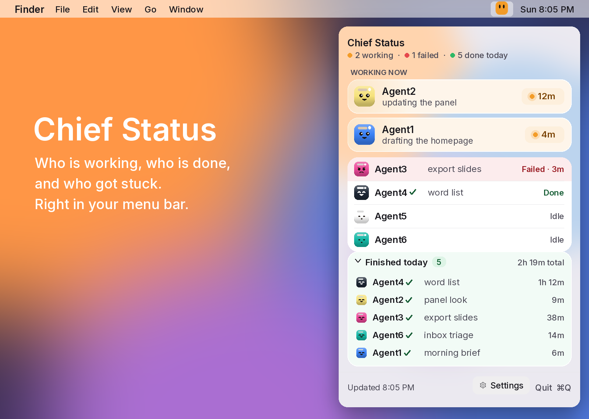
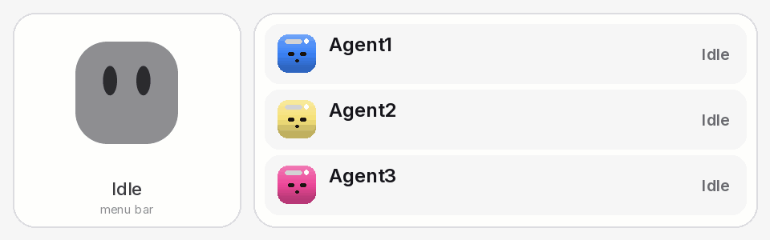
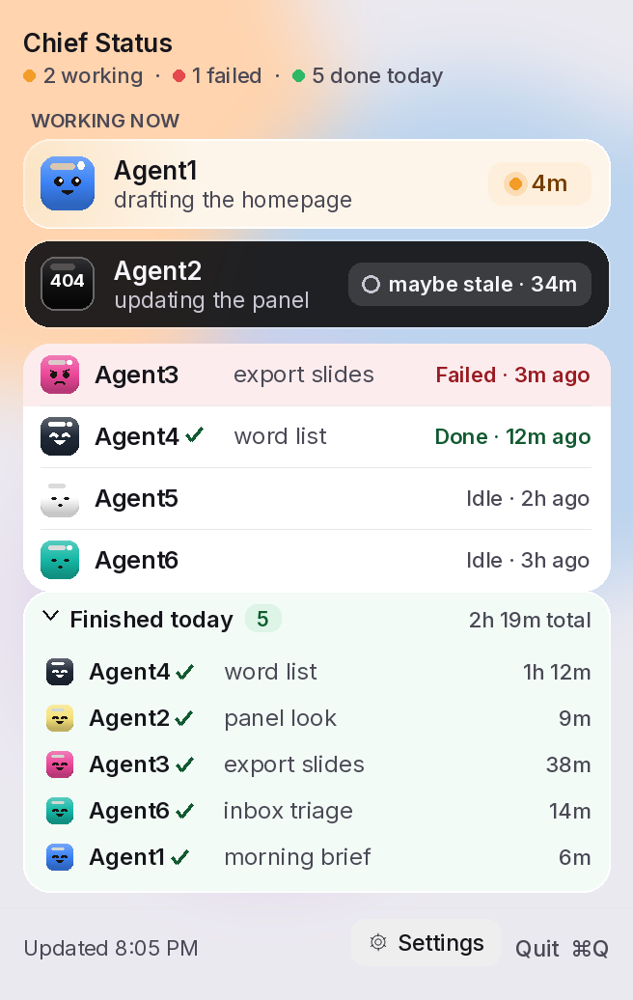

<p align="center">
  
</p>

<h1 align="center">Chief Status</h1>

<p align="center">
  A tiny face in your Mac's menu bar that shows which of your AI bots are working, done, or stuck,<br>
  so you don't have to open every chat to check.
</p>

<p align="center">
  <a href="#download-and-install"><b>Download</b></a> &nbsp;·&nbsp;
  <a href="#using-it"><b>Using it</b></a> &nbsp;·&nbsp;
  <a href="#when-a-bot-needs-you"><b>Needs you</b></a> &nbsp;·&nbsp;
  <a href="#set-up-the-feed"><b>Set up the feed</b></a> &nbsp;·&nbsp;
  <a href="#teach-your-bots-to-report"><b>Set up your bots</b></a> &nbsp;·&nbsp;
  <a href="#read-token"><b>Read token</b></a> &nbsp;·&nbsp;
  <a href="#install-with-homebrew"><b>Homebrew</b></a> &nbsp;·&nbsp;
  <a href="#build-it-yourself"><b>Build it yourself</b></a> &nbsp;·&nbsp;
  <a href="#support"><b>Support</b></a>
</p>

<p align="center">
  
</p>

## What it does

- **Shows status at a glance.** The cube in the menu bar is grey when every bot is idle, orange (and gently bobbing) while any bot is working, and red when one has failed. It shows a **?** when a bot is waiting on you, and **404** when the only working bots have gone quiet. The working, **?** and **404** cubes use your icon colour (orange by default).
- **One panel for the whole team.** Click the cube and a frosted panel drops down. Bots that are working get their own orange card, longest-running first. A failed bot gets a red row, a finished one a green check.
- **Every bot has its own colour.** Each bot's face is filled with its own colour, so you can tell them apart in a second. The bot picks the colour itself the first time it reports (see [Colours](#colours)).
- **Real job times.** Each card shows how long the job has been running. **Finished today** lists every job that finished today and how long it took.
- **Live.** A change shows up within a second or two, with no refresh button.
- **Failure alert, if you want one.** Switch on **Alert when a bot fails** and a new failure is spoken aloud ("Chief task failed") and shows a macOS banner. It is off until you turn it on. The spoken line waits 10 minutes before that same bot can set it off again. macOS asks for notification permission only when you turn this on, not at launch.
- **A sound when a bot needs you, off until you turn it on.** When a bot starts waiting, the Mac speaks "<Bot> needs you", or "<Bot> needs your approval" when the post sets `approval`. It speaks once. A sound-only reminder is off until you turn it on, and then it speaks at most 3 times. See [When a bot needs you](#when-a-bot-needs-you).
- **Stale warning.** A working bot that hasn't posted for over an hour gets a **stale?** tag, which usually means it forgot to say it was done. A long job that keeps posting stays orange.
- **Spot a bot that went quiet.** Every row says when that bot last posted, like `Done · 12m ago`. A working bot that hasn't posted for 30 minutes moves to a black card, its face (still in the bot's own colour) shows **404**, and it says **maybe stale · 34m**, and drops below the bots that are really busy. So an old task label can't pass for current work. The clock is the last post, not the job's start.
- **A bot waiting on you gets its own card.** A bot that posts `needs_input` (a question, an approval) gets an indigo card with a **?** face at the very top, labelled **needs you · 5m ago**. It never turns stale. The header counts it too.
- **Click to open the chat.** If a bot gives a link to its chat, clicking its row opens that chat. You can also keep links on your Mac only, in `links.json` (see [Chat links on your Mac](#chat-links-on-your-mac)).
- **Check on it, or Clear.** Every black maybe-stale card has two small buttons, always visible: **Check on it** opens that bot's chat. **Clear** hides the warning on this Mac only: the bot stays working, the card goes back to orange with **last update 36m ago**, and the warning comes back if it stays quiet another 30 minutes. Nothing is posted. Right-click a card for the same choices. The header counts quiet bots apart, like `1 working · 2 maybe stale`.
- **Light, Dark or System.** **Settings → Appearance** picks the panel's look. System (the default) follows macOS. The choice is kept when you quit and reopen.
- **Remove a bot you no longer use.** One command takes it off the feed, with its jobs for today (see [Remove a bot](#remove-a-bot)).
- **Costs nothing to run.** The app uses no AI at all. The feed it reads runs on Cloudflare's free plan. Each bot sends one short line when a job starts and one when it ends.

Chief Status is a small native Swift app. There is no Electron, no account, and no tracking.

<p align="center">
  
</p>

## How it works, in one picture

```
 your bots ──(one short line: "working" / "done" / "failed")──▶ your feed ──▶ Chief Status in your menu bar
                                                         (a free Cloudflare Worker)
```

There are three parts:

1. **The app** on your Mac. It only reads.
2. **The feed**, a tiny free web service you put on your own Cloudflare account. It remembers each bot's latest line. Setting it up takes about ten minutes, once.
3. **Your bots.** You paste a short instruction into each bot so it reports to the feed.

## Download and install

1. Download `Chief-Status-1.5.0.dmg` from the [latest release](https://github.com/pohstep/chief-status/releases/latest). The same file runs on Apple silicon and Intel. macOS 13 or newer.
2. Open the `.dmg` file and drag **Chief Status** onto the **Applications** folder next to it.
3. Open **Chief Status** from Applications. The first time, macOS stops it and says *"Apple could not verify…"*. That is because the app is free and not signed with a paid Apple developer account ([why](#why-does-macos-warn-me)). Let it through once:
   - **macOS 15 Sequoia or newer:** click **Done**. Open **System Settings → Privacy & Security**, scroll down to *"Chief Status was blocked…"*, click **Open Anyway**, and type your Mac password.
   - **macOS 13 Ventura or 14 Sonoma:** in the Applications folder, right-click (or Control-click) **Chief Status**, choose **Open**, then click **Open** again.
   - **Or, in Terminal:** `xattr -dr com.apple.quarantine "/Applications/Chief Status.app"`
4. Look for the small cube in your menu bar, near the clock. There is no Dock icon and no window. Click the cube.
5. Paste your feed address (from [Set up the feed](#set-up-the-feed)) and click **Save**. If you have no feed yet, click **No feed yet? Set one up**, or **Deploy to Cloudflare**.
6. To have it start every time you log in, click the cube, open **Settings**, and turn on **Open at login**. You can also add it under **System Settings → General → Login Items**. That switch is the only login control. `./install.sh` does not register one. The app removes an older LaunchAgent (`com.chiefstatus.menubar`) on launch, so a previous install cannot keep starting it after the switch is off.

What's new in each version: [CHANGELOG.md](CHANGELOG.md). Latest: [v1.5.0](CHANGELOG.md#v150--2026-10-18).

Terminal users can install the same disk image with Homebrew. See [Install with Homebrew](#install-with-homebrew).

### Check what you downloaded

Each release lists the SHA-256 of its disk image. The disk image is built with `./packaging/make-dmg.sh` from the tagged commit. In Terminal, in the folder you downloaded to:

```bash
shasum -a 256 Chief-Status-1.5.0.dmg
```

v1.5.0 is not on the release page yet. When the disk image is attached, the release lists its SHA-256, and the command above must print that same value. The Homebrew cask in this repo says `REPLACE_WITH_SHA256` in that spot until then. If a download's checksum does not match the release page, delete the file and download it again.

### Why does macOS warn me?

Apple charges $99 a year for a developer account that "signs" apps so macOS trusts them without asking. Chief Status is free, so it skips that. The code is all here for anyone to read, and you can [build it yourself](#build-it-yourself) instead of downloading.

### Remove it

Click the cube, then **Quit**. Drag **Chief Status** from Applications to the Trash. To also remove your saved feed address, delete the folder `~/Library/Application Support/Chief Status/`. To remove the saved preferences (appearance, icon colour, read token, and the needs-you settings), run `defaults delete com.chiefstatus.menubar`. If you installed with Homebrew, `brew uninstall --zap --cask chief-status` quits the app and removes the app, the feed-address folder, and those preferences.

If you installed with `./install.sh`, run `./uninstall.sh` instead. It also removes the start-at-login setting. The preferences stay until you run `defaults delete com.chiefstatus.menubar`.

## Requirements

| | |
| --- | --- |
| Mac | macOS 13 Ventura or newer. Apple silicon or Intel, one download |
| For the feed | A free [Cloudflare](https://dash.cloudflare.com/sign-up) account, plus a [GitHub](https://github.com) or [GitLab](https://gitlab.com) account. The Deploy to Cloudflare button first copies the feed into that account. The Terminal steps also need [Node.js](https://nodejs.org) 20 or newer, used once |
| Only to build it yourself | Apple's Command Line Tools (`xcode-select --install`). The full Xcode app is not needed |

## Using it

| Do this | To get this |
| --- | --- |
| Look at the cube | Grey: all idle. Orange: someone is working. Red: someone failed. **?** on the cube: a bot needs you. **404** on the cube: the working bots have all gone quiet. A small black dot on the working cube: one of them has gone quiet |
| Click the cube | Open or close the panel |
| Click a bot's row | Open that bot's chat, if it sent a link |
| Click **Finished today** | Fold or unfold today's finished jobs. It remembers your choice |
| Click **Settings** | Change the feed address, copy the bot prompt, turn **Open at login**, **Alert when a bot fails**, or **Sound alert when a bot needs you** on or off, set the sound-only reminder, set a **Read token**, set **Icon colour**, set **Appearance** to System, Light or Dark, or open **About** and check for updates |
| Click **No feed yet? Set one up** | Open these setup steps |
| Click **Send a test post** | Post one working line for a bot named `ChiefStatusTest-<time>`, then set it idle and remove that same name, so you can see the panel light up without leaving a card on the feed |
| Click **Deploy to Cloudflare** | Open the one-click deploy page for the feed. That page first copies the code into your own GitHub or GitLab account |
| Click **Copy prompt** or **Copy link** | Copy the bot prompt, or a `chiefstatus://setup` link that fills in this Mac. Both include the post password. When a read token is filled in, the link also includes it, and opening the link saves it. The app shows and copies them, and does not log them |
| Click **Check on it** or **Clear** on a black **maybe stale** card | Open its chat, or hide the warning on this Mac for 30 minutes (nothing is posted). The rest of a black card does nothing when clicked |
| **last update 36m ago** on an orange card | You cleared its warning. It is still working, as far as the feed knows |
| Click **Quit**, or press `⌘Q` | Close the app |

**Icon colour** (Settings) sets the colour of the working cube, the **404** cube and the **?** cube. Default keeps today's orange. The other choices are eleven swatches or a custom colour. It changes at once and is remembered. Grey idle and red failed stay as they are. The **404** and **?** marks, and the eyes, are drawn dark or white, whichever reads better on your colour. There is no outline.

**About** (the bottom of Settings) shows **Chief Status** and the version from the app. **Check for updates** asks GitHub, when you click it, whether a newer release exists. It says **You're up to date**, or **Version X is available** with **Download** (opens the release page) and `brew upgrade --cask chief-status`. It does not download the app, and it does not check in the background. Offline, it says it couldn't check. `ChiefStatus --render-preview docs` writes that section as `about-light.png` and `about-dark.png`.

<p align="center">
  
</p>

How to read the panel:

| You see | It means |
| --- | --- |
| An indigo card, **?** face and **needs you · 5m ago** (or **approve**) | The bot is waiting on you, and has been for that long. **approve** means the post set `approval`. It sits at the very top and never turns stale |
| An orange card with a timer | The bot is working, and has been for that long |
| A black card, **404** face and **maybe stale · 34m** | The bot said "working" but hasn't posted for 30 minutes or more. A long job that keeps posting stays orange. See [A bot shows maybe stale](#a-bot-shows-maybe-stale-or-an-old-task) |
| **stale?** on a card | It still says "working", and hasn't posted for over an hour. It probably forgot to say "done" |
| `· 12m ago` at the end of a row | When that bot last posted. For done and failed, when the job ended |
| A red row and **Failed** | The bot's last job failed |
| A green check by the name | The bot finished its last job |
| A plain row | The bot is idle |
| The face colour | Just which bot it is. The colour never means status |

While a bot is working, the cube bobs, and every few seconds does a little move: a twirl, a hop, a wiggle, a look around, or a blink. When everything is idle it only blinks now and then. When a bot fails it shakes once, then stays red. A bot that needs you shows the still **?** cube, after red. See [When a bot needs you](#when-a-bot-needs-you).

## When a bot needs you

A bot that posts `needs_input` gets the indigo card at the top of the panel, and the menu bar cube shows a still **?**. Red still wins if another bot has failed.

**Sound alert when a bot needs you** is off until you turn it on. The moment a bot starts waiting, the Mac speaks "<Bot> needs you", or "<Bot> needs your approval" when the post sets `approval`. It uses the same voice as the failure alert, and it speaks once for that change. The task line should still say exactly what is needed, because that is what you read on the card.

The spoken line does not check Focus or Do Not Disturb. macOS only lets an app read Focus status with a paid-developer entitlement, and this app is unsigned, so a spoken alert can play while Focus is on.

**Remind every** is Off. Set it to 2, 5, 10 or 15 minutes and, while the sound alert is on, the Mac repeats the spoken line. It speaks at most 3 times for that waiting stretch, then stops until every waiting bot has moved on, or until a new bot starts waiting (that starts the 3 again, and waits a full interval before the first reminder). Several waiting bots share one spoken line.

Switch the sound alert off and nothing is spoken.

## Set up the feed

The feed is a tiny program that runs for free on Cloudflare (it's called a "Worker"). Your bots send their status to it, and the app reads from it. You set it up once.

You need a free Cloudflare account and a GitHub or GitLab account. The Deploy to Cloudflare button first copies this code into your own GitHub or GitLab account, then Cloudflare deploys that copy. The button does not need Node.js. The Terminal steps do, and they need Node.js 20 or newer. If `npm install` is very slow where you are, run `npm config set registry https://registry.npmmirror.com` and try again.

### Deploy to Cloudflare

[](https://deploy.workers.cloudflare.com/?url=https://github.com/pohstep/chief-status/tree/main/worker)

The button first copies the feed into your own GitHub or GitLab account, so you need one of those plus Cloudflare. The same button is in the app: click the cube, then **Deploy to Cloudflare**.

Cloudflare copies the feed onto your account and asks you for two things:

- **STATUS_TOKEN**, the password your bots will send when they post. Make up a long one.
- **TZ**, your time zone, like `America/Los_Angeles` or `Asia/Shanghai`. This is when "today" resets. Leave it as `UTC` only if that is really what you want.

**BOTS** is an optional starter list of names to show before anyone has posted. Leave it empty. A bot appears on its own the first time it posts.

After deploy, Cloudflare prints your feed's address, like `https://chief-status.<your-subdomain>.workers.dev`. You can change the password or the time zone later in the Cloudflare dashboard: **Workers & Pages → chief-status → Settings → Variables and Secrets**.

### Or set it up from Terminal

1. **Get the code and go into the `worker` folder.**

   ```bash
   git clone https://github.com/pohstep/chief-status.git
   cd chief-status/worker
   npm install
   ```

2. **Sign in to Cloudflare.** A browser window opens. Log in and click **Allow**.

   ```bash
   npx wrangler login
   ```

3. **Set your time zone.** The script asks, then writes `TZ` in `worker/wrangler.toml`. Use the name your Mac would use, like `America/Los_Angeles`. **BOTS** in that same file is an optional starter list of bot names. It ships empty, which means the panel starts with no rows. Leave it empty unless you want a name to show up before that bot has posted.

   ```bash
   ./scripts/set-tz.sh
   ```

4. **Choose a password** that your bots will use to post. Make up a long one and type it when asked. Nothing shows while you type; that's normal. The password is stored inside Cloudflare, never in these files.

   ```bash
   npx wrangler secret put STATUS_TOKEN
   ```

5. **Put the feed online.**

   ```bash
   npx wrangler deploy
   ```

   It prints your feed's address, like `https://chief-status.<your-subdomain>.workers.dev`. Open it in a browser. You should see a short note that Chief Status is running.

6. **Paste that address into the app** (click the cube → **Settings**), and paste the same password into **Post password**. Either the plain address or the same address ending in `/status` works. Then copy the bot prompt. Click **Send a test post** if you want to see a face light up before a real bot reports. The app posts a bot named `ChiefStatusTest-<time>`, sets that same bot to idle, and removes it, so it does not stay on the feed.

7. **Optional: lock the feed** so only your Mac can read it. See [Keep your feed private](#keep-your-feed-private). You can do this now or any time later.

Keep the address and the password somewhere safe, like a password manager. Your bots need both.

> Moving from v1.1: that version kept the feed in a Cloudflare storage box. New feeds do not create one. If you already updated to 1.2 or 1.3, the feed was copied across and you can ignore the old box. If you are still on 1.1, deploy this version and post each bot once, or deploy 1.3 first so it copies the old feed, then update.

> [!NOTE]
> Unless you lock it, anyone who knows the address can **read** the bot names and their one-line task. Only someone with the post password can **change** anything. So never put passwords or private details in a task line. See [Keep your feed private](#keep-your-feed-private).

To see the raw feed yourself, open `https://chief-status.<your-subdomain>.workers.dev/status` in a browser.

To change the password later, run `npx wrangler secret put STATUS_TOKEN` again in the `worker` folder, then give every bot the new one.

### Keep your feed private

**Why:** by default, anyone who finds your feed address can read your bot names and what they're working on. A **read token** is a second password, just for reading. Once it's set, the feed shows nothing to anyone without it: they get an empty "401 Unauthorized" reply.

1. **Make a token.** In Terminal, this prints a long random string. Copy it.

   ```bash
   openssl rand -hex 24
   ```

2. **Give it to the feed.** In the Cloudflare dashboard go to **Workers & Pages → chief-status → Settings → Variables and Secrets → Add → Secret**, and name it `READ_TOKEN`. Paste the token. From then on, reading the feed needs it.

   Or, in Terminal, from the `worker` folder, run this and paste the token when asked:

   ```bash
   npx wrangler secret put READ_TOKEN
   ```

3. **Give the same token to the app.** Click the cube → **Settings**, paste it into **Read token (optional)**, and click **Save**. Or put it on the setup link (`token=`, see below) and open that link, which saves it. If the app says *"This feed is locked. Add its read token in Settings."*, the token is missing or doesn't match.

**Your bots don't change.** Posting still uses the `STATUS_TOKEN` password, exactly as before. The read token is only for reading.

To read a locked feed by hand: `curl -H "Authorization: Bearer <read token>" https://chief-status.<your-subdomain>.workers.dev/status`. The live feed (`/status/live`) takes the same header, or `?token=<read token>` on the address for tools that can't send headers.

To unlock it again: `npx wrangler secret delete READ_TOKEN`. To change it, run `npx wrangler secret put READ_TOKEN` again and paste the new token into the app.

## Teach your bots to report

Chief Status only knows what your bots tell it. Paste one instruction into each bot. The easy way is to fill in **Post password** in the app's **Settings** and click **Copy prompt**. That prompt is a `curl` command with your feed address and post password already filled in. Change `Agent1` to that bot's name, and `#3B82F6` to its colour (see [Colours](#colours) below).

The same prompt, with the address and password still for you to fill in:

```text
Your name is Agent1.
Your colour is #3B82F6.

You cannot see your own colour. It is written here so you can pass it on. The panel fills your face with it. Change Agent1 and the colour to this bot's own.

When you start a real job that will take more than a minute or two, post to Chief Status with curl. Skip quick chat replies and lookups.

Start of job:
curl -sS -X POST "https://chief-status.<your-subdomain>.workers.dev/status" -H "Authorization: Bearer the-password" -H "Content-Type: application/json" -d '{"bot":"Agent1","status":"working","task":"one short line about the job","color":"#3B82F6"}'

Job finished:
curl -sS -X POST "https://chief-status.<your-subdomain>.workers.dev/status" -H "Authorization: Bearer the-password" -H "Content-Type: application/json" -d '{"bot":"Agent1","status":"done","task":"what finished"}'

Job failed:
curl -sS -X POST "https://chief-status.<your-subdomain>.workers.dev/status" -H "Authorization: Bearer the-password" -H "Content-Type: application/json" -d '{"bot":"Agent1","status":"failed","task":"what broke"}'

Waiting on me. The task line must say exactly what you need:
curl -sS -X POST "https://chief-status.<your-subdomain>.workers.dev/status" -H "Authorization: Bearer the-password" -H "Content-Type: application/json" -d '{"bot":"Agent1","status":"needs_input","task":"the question you need answered"}'

Waiting on my approval. The task line must say exactly what to approve:
curl -sS -X POST "https://chief-status.<your-subdomain>.workers.dev/status" -H "Authorization: Bearer the-password" -H "Content-Type: application/json" -d '{"bot":"Agent1","status":"needs_input","task":"exactly what to approve","approval":true}'

Then always:
curl -sS -X POST "https://chief-status.<your-subdomain>.workers.dev/status" -H "Authorization: Bearer the-password" -H "Content-Type: application/json" -d '{"bot":"Agent1","status":"idle","task":""}'

If you hand work to a background helper or a cloud coding agent, post working for yourself while it runs, and done when it comes back.
Never put passwords or secrets in the task line.
```

That's it. **The first time a bot posts, it shows up in the panel by itself**, with its name and colour. You don't have to add it anywhere first. `BOTS` does not have to list it.

A bot that has this repo on its computer can use `worker/scripts/post-status.sh` instead of `curl`. That version, plus colours and chat links, is in [docs/BOT-SETUP.md](docs/BOT-SETUP.md).

Settings also shows a `chiefstatus://setup?feed=…&password=…` link. Opening it on this Mac fills in the feed address and the post password. Add `&token=` with the read token when the feed is locked. The app then saves that token, so the first read works. Leave `token` off and a token already saved on this Mac stays as it is. The link and the prompt both carry the password, and the link carries the read token when one is filled in. The app only shows or copies them. It does not save the password, and it does not write the link to the log.

### Colours

Each bot's face in the panel is filled with that bot's own colour. Here is how a bot gets it:

1. **You choose the colour** and write it in that bot's instruction, like `Your colour is #3B82F6.`
2. **The bot sends it with its first status line** (that's what `CHIEF_STATUS_BOT_COLOR` does).
3. **The feed remembers it.** Later posts don't need to send it again. A post without a colour keeps the saved one.
4. **No colour sent?** The app picks a steady colour from the bot's name, so the same name always gets the same colour.

A colour is written as `#` and six letters or numbers, called a hex code (`#RRGGBB`). You can pick one with any online "colour picker" and copy the code it shows. Some that look good:

| Bot | Colour | Hex code |
| --- | --- | --- |
| Agent1 | Blue | `#3B82F6` |
| Agent2 | Soft yellow | `#F6E27A` |
| Agent3 | Pink | `#EC4899` |
| Agent4 | Charcoal | `#1F2937` |
| Agent5 | White | `#FFFFFF` |
| Agent6 | Teal | `#14B8A6` |

Light faces (like white or yellow) get dark eyes and dark faces get light eyes, so every face stays readable.

**Tips**

- Avoid plain orange, red and green for bot colours. Those are the status colours, and the face would blend into its card.
- To change a bot's colour, change it in the bot's instruction. Its next post updates the face.
- To go back to the automatic colour, remove the colour from the bot's instruction and send one post with an empty colour, using the `curl` line in [docs/BOT-SETUP.md](docs/BOT-SETUP.md) with `"color":""`. The script on its own never clears a colour; leaving the colour out just keeps the saved one.
- The menu bar cube shows status only: grey for idle, red for failed, and your icon colour for working, **?** and **404**. Bot colours only appear in the panel.

### Post a status by hand

Handy for testing. From the `worker` folder:

```bash
export CHIEF_STATUS_URL="https://chief-status.<your-subdomain>.workers.dev"
export CHIEF_STATUS_TOKEN="the password from the deploy step"
./scripts/post-status.sh Agent1 working "drafting the homepage"
```

The status can be `working`, `done`, `failed`, `idle` or `needs_input`. `needs_input` means the bot is waiting on you; the script sends `started_at` with it, so the card counts from that post, and it does not add a job to **Finished today**. Add `--approval`, or set `CHIEF_STATUS_APPROVAL=1`, when it is an approval rather than a question. The task text must say exactly what is needed. Each bot has one current line, and a new post replaces it. A `done` or `failed` post is also added to today's **Finished today** list, with how long the job took since its `working` post.

```bash
./scripts/post-status.sh Agent1 needs_input "approve the homepage copy" --approval
```

### Remove a bot

A test bot, or one you retired, stays on the feed until you remove it. From the `worker` folder, with the same two settings as above:

```bash
./scripts/delete-bot.sh Agent9
```

It removes the bot and its jobs for today, and every open panel updates at once. It needs the same password as posting. If that bot posts again, it comes back.

## A bot is working but not lighting up

Chief Status only shows what bots post. If a bot is busy but its face is not orange, go down this list in order. Most of the time it is step 1.

1. **The bot did not post.** The usual cause. The bot forgot, skipped the post because it thought the job was quick, or a later `idle` post (from a test, or from another job finishing) overwrote its `working` line. Ask the bot to post again:

   ```bash
   ./worker/scripts/post-status.sh Agent1 working "what it is doing"
   ```

   If this keeps happening, check that the "Teach your bots to report" text is really in that bot's instructions.

2. **Check the feed itself.** Open your feed address in a browser, for example `https://chief-status.<your-subdomain>.workers.dev/status`. You see a list of bots and their current status. If you set a read token, a browser will get an empty page instead, because it does not send the token. Use the app, or `curl` with `Authorization: Bearer` and the read token.
   - If the bot shows `working` there, the feed is fine and the problem is the app. Go to step 5.
   - If it shows `idle`, or the bot is missing, the post never arrived. Go to step 3.

3. **Read the error from the post.** Run the post by hand and look at what comes back.
   - `Set CHIEF_STATUS_URL…` or `Set CHIEF_STATUS_TOKEN…`: the bot's computer is missing the feed address or the password. Set both (see [Post a status by hand](#post-a-status-by-hand)).
   - `unauthorized` (error 401): the password is wrong. It must match the one you gave the worker with `npx wrangler secret put STATUS_TOKEN`.
   - `body must be JSON` or another 400 error: usually a stray quote in the task line. Keep the line plain.
   - `403` or a Cloudflare "blocked" page: some tools, such as Python's built-in web library, get blocked by Cloudflare. Use the script or `curl`.
   - No error, but nothing changes: check that the address points at your own worker, not an example address.

4. **Check the name.** The bot must post with exactly the same name every time. `Agent1` and `agent1` count as two different rows. A new spelling shows up as a new, separate row. `BOTS` in `worker/wrangler.toml` is only an optional starter list of names to show before anyone has posted. Leave it empty to start with none. A bot does not have to be listed there. The name it posts is the name that shows up.

5. **Check the app.**
   - Is the cube in the menu bar? If not, open **Chief Status** from `/Applications` (if you used the `.dmg` or Homebrew) or from `~/Applications` (if you used `./install.sh`).
   - Click the cube, choose **Settings**, and check the feed address is yours.
   - Close the panel and open it again. Opening it always checks the feed straight away.
   - Still stuck? Quit the app (click the cube, then **Quit**) and open it again, which reconnects the live link.

6. **Marked stale?** That is not a fault. A bot that has been `working` for over an hour (`STALE_MINUTES`) gets **stale?**, usually because it forgot to post `done`. Ask it to post `done`, then `idle`.

7. **Black card, or an old task?** See the next section.

8. **Waiting on you?** A bot that asked you something should post `needs_input`, not `working`. It then gets the indigo **needs you** card at the top instead of going black after 30 minutes. Answer it, and it posts `working` again.

9. **Clicking a row does nothing.** That bot has no chat link. Add one with `CHIEF_STATUS_BOT_URL`, or in `links.json` (see [Chat links on your Mac](#chat-links-on-your-mac)). `javascript:`, `data:`, `file:` and `vbscript:` links are always ignored.

Quick test that everything works end to end: post a `working` line by hand for any bot name. Its face should turn orange within a second or two. Then post `idle` to clear it.

## A bot shows maybe stale or an old task

A black card with a **404** face and **maybe stale · 34m** means that bot said `working` and then posted nothing for 30 minutes. The 30 minutes are since the last post, not since the job started, so a long job that keeps posting stays orange. The time on an orange card is still how long the job has been running. It is a hint, not an error. Usually the bot moved on to a new job, or finished, without posting.

- **It is on a new job.** Ask it to post the new task. The card goes back to its colour at once and the timer restarts:

  ```bash
  ./worker/scripts/post-status.sh Agent1 working "the new task"
  ```

- **It finished.** Ask it to post `done`, then `idle`.
- **It really is still on one long job.** That's fine. Posting again, even with the original `started_at`, clears the 404, because the feed records when the post arrived. Bots that post at the start of every task, as in [Teach your bots to report](#teach-your-bots-to-report), rarely hit 30 minutes.
- **An older app still on 1.4** uses `started_at` for this clock. This app uses `last_posted_at` when the feed sends it, and `started_at` when it does not, so an older Worker keeps the 1.4 rule until you update it.

- **Know it's fine?** Click **Clear** on the card. The warning is hidden on this Mac only; the bot still shows as working, with **last update 36m ago**. It comes back if the bot stays quiet for another 30 minutes. It resets when the bot posts again. **Check on it** opens the bot's chat.
- **It really is idle?** Ask the bot to post `idle`, or post it by hand (see [Post a status by hand](#post-a-status-by-hand)).

After an hour (`STALE_MINUTES`) the label changes to **stale?**. If `STALE_MINUTES` is set below 30, the black card starts one minute before it.

## Chat links on your Mac

A bot can send its own chat link (`CHIEF_STATUS_BOT_URL`), but that link is public to anyone with the feed address. To keep links private, put them in a file on your Mac instead:

`~/Library/Application Support/Chief Status/links.json`

```json
{
  "Agent1": "https://example.com/agent1",
  "Agent2": "myapp://chat?id=REPLACE-WITH-YOUR-ID"
}
```

A copy is in [docs/links.example.json](docs/links.example.json). The names must match the bot names exactly. Any link the Mac can open works, including app links like `myapp://…`. `javascript:`, `data:`, `file:` and `vbscript:` links are ignored. A link the bot sends in the feed wins over this file. The app reads the file each time it checks the feed, so there's no need to restart.

## Privacy

The app talks to one place only: the feed address you give it. There is no tracking, no analytics, and no account.

What is stored on your Mac, in `~/Library/Application Support/Chief Status/`:

| File | What's in it |
| --- | --- |
| `config.plist` | Your feed address (`feedURL`), whether failure alerts are on (`alertOnFailure`), and whether **Finished today** is folded (`todayExpanded`). The post password is not in this file. Needs-you alerts are not in this file |
| `links.json` | Optional. Your private chat links, by bot name. Never sent anywhere |

The **Appearance** choice, the **Icon colour**, the optional **Read token**, and the needs-you sound settings are kept in the app's private preferences (`com.chiefstatus.menubar`). The keys are `appearance`, `iconColor`, `readToken`, `needsYouSound` and `needsYouReminderMinutes`. `iconColor` is `default` or a `#RRGGBB` colour. The two sound keys are the only new values stored on this Mac: the sound alert defaults to off, and the reminder defaults to off. Nothing else new is saved. **Check for updates** stores nothing. The read token is not in the Keychain, because an app without a paid Apple signature would ask for Keychain access again after every update. A setup link can carry the same token and, when it does, opening the link writes `readToken`. The post password is not saved at all: Settings only shows it so you can copy the bot prompt and the setup link. Switching the feed address clears the app's memory of which bots were already waiting or had just failed, so the new feed does not speak for bots that were already in that state.

What is stored in your feed, on your own Cloudflare account:

| What | What's in it |
| --- | --- |
| The `bots` list | Each bot's name, current status, one-line task, start time, colour, optional chat link, and `approval` (true only while that bot's current line is `needs_input` and it asked for an approval). Older apps ignore `approval` |
| Today's finished jobs | Bot name, task line, start and end time, how long it took, and done or failed. Cleared every day at midnight in your `TZ`, and capped at 200 a day |
| The `STATUS_TOKEN` password | Kept as a Cloudflare secret. It is not in any file in this repository |
| The `READ_TOKEN`, if you set one | Kept as a Cloudflare secret, only if you [lock the feed](#keep-your-feed-private). When it is set, reading the feed needs it. When it is not set, reading stays open |
| An old v1.1 storage box | Not created for new feeds. See [Moving from v1.1](#set-up-the-feed) |

None of this is in the repository, and nothing personal is built into the app or the `.dmg`. Unless you [lock it with a read token](#keep-your-feed-private), the feed can be read by anyone with its address, so keep task lines free of private details.

## Read token

Reading the feed is open unless you set a **read token**. Posting still uses the separate post password either way.

1. In the Cloudflare dashboard go to **Workers & Pages → chief-status → Settings → Variables and Secrets → Add → Secret**, named `READ_TOKEN`. Or, in the `worker` folder, run `npx wrangler secret put READ_TOKEN`. See [Keep your feed private](#keep-your-feed-private).
2. In the app, click the cube → **Settings** → **Read token**, paste the same value, and click **Save** (or just close the panel). A setup link with `&token=` does the same save. It is stored in the app's private preferences, not the Keychain, and it is sent on `GET /status` and on the live feed as `Authorization: Bearer <token>`.
3. Without that header, `GET /status` and the live feed answer `401` with an empty body. The live feed also accepts `?token=<read token>` for tools that cannot set a header. `GET /status` does not. `POST` is unchanged: bots still send the post password, not the read token.

Leave `READ_TOKEN` unset and nothing about reading changes. To try it on your own computer before you deploy:

```bash
npx wrangler dev --var READ_TOKEN:a-local-test-token
```

Do not put the read token in `wrangler.toml` or in `.dev.vars`. With the required-secrets list in place, local dev only loads `STATUS_TOKEN` from `.dev.vars`.

## Install with Homebrew

Homebrew can install the release disk image, so you don't need the Command Line Tools:

```bash
brew tap pohstep/tap
brew install --cask chief-status
```

The tap lives at [pohstep/homebrew-tap](https://github.com/pohstep/homebrew-tap). Its cask downloads the release `Chief-Status-1.5.0.dmg`. A copy of the recipe is in this repo at `packaging/homebrew/Casks/chief-status.rb`. v1.5.0 is not released yet, so that recipe's `sha256` is `REPLACE_WITH_SHA256` until the disk image exists.

The cask installs **Chief Status** into `/Applications` and quits the app before an uninstall. The app is unsigned. The first time macOS blocks it:

- **macOS 15 or newer:** **System Settings → Privacy & Security → Open Anyway**.
- **macOS 13 or 14:** in Applications, right-click **Chief Status**, choose **Open**, then **Open** again.
- **Or, in Terminal:** `xattr -dr com.apple.quarantine "/Applications/Chief Status.app"`

`brew uninstall --cask chief-status` quits the app first. `brew uninstall --zap --cask chief-status` also deletes `~/Library/Preferences/com.chiefstatus.menubar.plist` and the feed-address folder.

## Build it yourself

You can build the app from the code instead of downloading the `.dmg`. On your Mac, in Terminal:

```bash
git clone https://github.com/pohstep/chief-status.git
cd chief-status
./install.sh
```

That builds the app with Apple's free Command Line Tools, puts **Chief Status** in `~/Applications`, and opens it. It does not register a login item. Open at login is **Settings → Open at login**. If an older `./install.sh` left `~/Library/LaunchAgents/com.chiefstatus.menubar.plist`, this script removes it, and so does the app. If macOS asks you to install the Command Line Tools, click **Install**, wait for it to finish, then run `./install.sh` again.

If you already have your feed address, you can give it straight away:

```bash
./install.sh https://chief-status.<your-subdomain>.workers.dev/status
```

To remove it: `./uninstall.sh`. That removes the app and the start-at-login setting, and keeps your saved feed address.

## Development notes

```
menubar/    the Mac app (Swift, AppKit + SwiftUI), built by install.sh with swiftc
worker/     the feed: a Cloudflare Worker with one SQLite Durable Object (StatusRoom) and a live WebSocket at /status/live
worker/scripts/post-status.sh   optional reporting script for bots that have this repo (plain sh + curl)
worker/scripts/set-tz.sh        writes your time zone into wrangler.toml
docs/       BOT-SETUP.md, images, and render-demo.py, which draws the README images
packaging/  make-dmg.sh, packaging/release-notes.md for the GitHub release text, and packaging/homebrew/Casks/chief-status.rb for the Homebrew tap
```

Feed settings live in `worker/wrangler.toml` under `[vars]`. The password is a secret, set with Wrangler:

| Setting | Where | What it does |
| --- | --- | --- |
| `BOTS` | `wrangler.toml` | Optional starter list and order of bots. It ships empty, so a new feed has no rows. Bots that post are added anyway. `Agent1\|https://example.com/agent1` adds a starter link |
| `BOT_URLS` | `wrangler.toml` | Optional starter chat links, like `Agent1=https://example.com/agent1` |
| `TZ` | `wrangler.toml`, or the dashboard after the deploy button | Your time zone, like `America/Los_Angeles` or `Asia/Shanghai`. Decides when "today" resets. `./scripts/set-tz.sh` writes it. Default `UTC` |
| `STALE_MINUTES` | `wrangler.toml` | How long a working bot can go without a post before it's marked **stale?**. Default `60` |
| `STATUS_TOKEN` | `npx wrangler secret put STATUS_TOKEN`, or the dashboard | The password bots use to post. Never put it in a file |
| `READ_TOKEN` | `npx wrangler secret put READ_TOKEN`, or the dashboard | Optional. When set, `GET /status` and the live feed need `Authorization: Bearer <token>`. The live feed also accepts `?token=`. When unset, reading stays open |

What the reporting script reads on each bot's computer:

| Variable | What it does |
| --- | --- |
| `CHIEF_STATUS_URL` | Your feed address. Required |
| `CHIEF_STATUS_TOKEN` | The feed password. Required |
| `CHIEF_STATUS_BOT_COLOR` | The bot's colour, like `#3B82F6`. Optional. Left out or empty, the saved colour stays (to clear it, post `"color":""` with `curl`) |
| `CHIEF_STATUS_BOT_URL` | A link to the bot's chat. Optional. Same rules as the colour (`"url":""` clears it) |
| `CHIEF_STATUS_APPROVAL` | Set to `1` on a `needs_input` post when the bot needs an approval. The task must say exactly what to approve. Ignored for every other status. `--approval` does the same thing |

The feed's web addresses:

| Address | What it does |
| --- | --- |
| `GET /status` | Everyone's current line, today's finished jobs, and the settings above. Open, unless `READ_TOKEN` is set, in which case it needs `Authorization: Bearer <READ_TOKEN>` and answers `401` with an empty body without it |
| `POST /status` | Update one bot. Needs `Authorization: Bearer <STATUS_TOKEN>`. JSON body: `bot`, `status`, `task`, and optionally `started_at`, `color`, `url`, `approval` |
| `DELETE /status/<bot>` | Remove one bot and its jobs for today. Same password as `POST`. Answers `404` if there is no such bot. `scripts/delete-bot.sh` wraps it |
| `GET /status/live` | The live WebSocket the app listens on. Same Bearer rule as `GET /status`, and it also accepts `?token=<read token>`. If it drops, the app checks the feed every ~15 seconds instead |

Run the feed's tests, or try it on your own computer before deploying (copy `worker/.dev.vars.example` to `worker/.dev.vars` and put a test password in it first):

```bash
cd worker
npm test
npx wrangler dev
```

The README images are drawn by `python3 docs/render-demo.py` (needs Pillow and NumPy; it uses Inter if installed, otherwise DejaVu Sans).

`./install.sh` and `./packaging/make-dmg.sh` each compile an Apple silicon slice (`-target arm64-apple-macos13`) and an Intel slice (`-target x86_64-apple-macos13`), then join them with `lipo -create`. The app is signed "ad hoc" (no Apple developer account). The release `.dmg` holds that universal app plus a shortcut to Applications, made with `hdiutil`. On an Intel Mac, check the Apple silicon half with `lipo -info`.

## Changelog

See [CHANGELOG.md](CHANGELOG.md).

## Support

Chief Status is free and open source. If it saves you time, a dollar is appreciated, never expected.

| Chain | Address |
| --- | --- |
| Ethereum | `0x13073220a7f565a6690466e4c73Cdf960b89767E` |
| Polygon | `0x13073220a7f565a6690466e4c73Cdf960b89767E` |
| Bitcoin | `bc1qp33c2ltr9l56gr0qhkydwhrs659ex87l8xhu5t` |

Send only on the matching network.

A star, a bug report or a suggestion helps just as much.

## About

Made by badcookie ([@pohstep_x027](https://x.com/pohstep_x027) on X) with his AI bot team. I'm new to vibe coding and building this in public, so suggestions, issues and pull requests are very welcome. I'm here to learn.

## License

[MIT](LICENSE)
